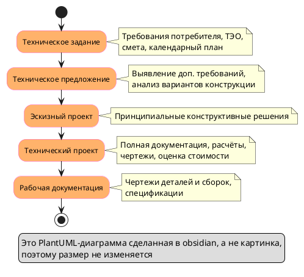

> 29.09.2026

[Как можно описать эту тему](https://www.youtube.com/watch?v=Fnmh1VO2zrI)
## Исторические и профессиональные основы технической документации
![[Pasted image 20260929100338.png|200]]
Техническая документация развивается согласно ГОСТ, обеспечивая стандартизацию и качество в промышленности, науке и строительстве, важна для систематизации процессов и изделий.

> [!Слайд 2]
> ГОСТ это единые правила оформления документации. Благодаря им все делают чертежи и инструкции одинаково. Так меньше путаницы и проще следить за качеством.

## Цели изучения технической документации

1. Образовательная цель сосредоточена на формировании представления о дисциплине, ее значении и основных понятиях для профессиональной деятельности.

2. Развивающая цель направлена на совершенствование навыков самостоятельного изучения и глубокого освоения материала студентами.

3. Воспитательная задача — формировать умение критически и самостоятельно мыслить, способствуя систематизации и эффективному усвоению знаний.

> [!Слайд 3]
> Задача в том, чтобы разобраться, что такое техническая документация и какую роль она играет в работе. Кроме того, важно научиться самостоятельно осваивать материал. И развить критическое мышление, чтобы знания были не заученными, а осмысленными.

## Определение технической документации

Техническая документация представляет собой совокупность текстовых и графических материалов, отражающих технические идеи и решения в проектировании и производстве.

Она включает чертежи, схемы, спецификации и технические описания, необходимые для разработки изделий и сооружений в различных отраслях.

> [!Слайд 4]
> Техническая документация — это все тексты и чертежи, в которых записано, как что-то придумали и как это делать. Сюда входят чертежи, схемы, спецификации и технические описания. По ним разрабатывают и изготавливают изделия и строят сооружения в самых разных отраслях.

## Основные виды технической документации

1. Конструкторская документация включает чертежи и описания, регламентированные ГОСТ и фиксирующие технические требования к изделиям.
2. Проектно-сметная документация ориентирована на архитектурно-строительные решения и оценку стоимости объектов капитального строительства.
3. Технологическая документация описывает процессы изготовления, сборки и контроля изделий с деталями технологических операций и регулированием процессов.
4. Научно-исследовательская, стандарты и патентная документация отражают научно-технические разработки, нормы и защиту интеллектуальной собственности.

> [!Слайд 5]
> Виды документации: конструкторская показывает, каким должно быть изделие. Проектно-сметная говорит, как строить и сколько это стоит. Технологическая объясняет, как изделие делать и проверять. Научные работы, стандарты и патенты фиксируют новые идеи, правила и авторство.

## Конструкторская документация: понятие и состав
![[gKPCYlLILLU_x4.png|200]]
1. Регламентируется ГОСТ и охватывает чертежи деталей, сборочных единиц, общего вида, теоретические и монтажные чертежи.

2. Текстовые документы включают технические описания, пояснительные записки, ведомости и спецификации, обеспечивающие полноту информации.

3. Чертежи содержат информацию о размерах, материалах, методах изготовления и технических характеристиках изделия.

4. Документы подразделяются на оригиналы, подлинники, дубликаты и копии в зависимости от способа изготовления и назначения.

> [!Слайд 6]
> Конструкторская документация оформляется по ГОСТ и состоит из чертежей и текстовых документов. Чертежи показывают, какого размера деталь, из чего и как её делать. Текстовые документы (описания, записки, спецификации) дополняют чертежи, чтобы ничего не потерялось. А сами документы бывают оригиналами и копиями, в зависимости от того, как их сделали.

## Чертеж в конструкторской документации
![[Pasted image 20260929102725.png|200]]

### Функциональное назначение чертежей  
  
Чертеж отражает конструкцию изделия с указанием размеров, материалов и способов изготовления. Он служит основой для производства и контроля качества.

### Виды чертежей и их особенности  
  
Включает детали, сборочные, общий вид, габаритные, монтажные и электротехнические схемы, обеспечивающие полное представление о конструкции и функционировании.

> [!Слайд 7]
> Чертёж показывает, как устроено изделие, какого оно размера, из чего сделано и как его изготовить. По нему детали делают и проверяют качество. Чертежи бывают разные: на отдельные детали, на сборку, общий вид, габариты, монтаж и электросхемы. Вместе они дают полную картину, как изделие устроено и как работает.

## Виды конструкторских чертежей и их описание
![[Pasted image 20260929103059.png|200]]

Таблица демонстрирует задачи и особенности различных видов чертежей, регламентированных ГОСТ ЕСКД.
Четкое разделение видов чертежей обеспечивает комплексное и стандартизированное отображение изделия.

| Вид чертежа   | Основное назначение              | Краткое содержание                       |
| ------------- | -------------------------------- | ---------------------------------------- |
| Деталь        | Обеспечение изготовления детали  | Изображение, размеры, материалы, допуски |
| Сборочный     | Показ сборочной единицы          | Расположение частей, схемы соединения    |
| Общий вид     | Представление изделия            | Изображения с разрезами, сечениями       |
| Теоретический | Определение формы и расположения | Геометрическая форма, координаты         |
| Габаритный    | Указание габаритов               | Контурное изображение, размеры           |
| Монтажный     | Инструкция по установке          | Контур и данные для монтажа              |
| Схема         | Общее устройство и связь         | Условные изображения и обозначения       |
> [!Слайд 8]
> Ми бомба
> 

## Текстовая документация в конструкторской области
- Включает технические описания, паспорта и расчеты, которые подробно объясняют конструктивные решения и их обоснование.
- В табличных формах представлены спецификации и ведомости, фиксирующие состав и характеристики изделий и комплектующих.
- Обеспечивает нормативное закрепление информации, необходимой для производства, контроля и эксплуатации изделий.

> [!Слайд 9]
> Деталь нужна, чтобы изготовить одну деталь: там размеры, материал и допуски. Сборочный показывает, как части соединяются в одно целое. Общий вид даёт представление об изделии целиком, с разрезами и сечениями. Теоретический задаёт форму и положение, габаритный показывает размеры по контуру, монтажный подсказывает, как устанавливать, а схема объясняет общее устройство и связи между частями.

## Типы документов по статусу и использованию
![[Pasted image 20260929104006.png|200]]
1. Оригиналы — это бумажные исходные документы, фиксирующие первичную техническую информацию. Они служат основой для создания официальных подлинников и последующего тиражирования всей технической документации в организации.

2. Подлинники, дубликаты и копии используются многократно на разных стадиях жизненного цикла продукта. Их подписывают ответственные специалисты, подтверждая качество и актуальность данных при проектировании, производстве и эксплуатации.

> [!Слайд 10]
> Оригинал это самый первый бумажный документ, где записана исходная техническая информация. С него делают официальные подлинники, а потом и копии для всей организации. Подлинники, дубликаты и копии используют много раз на разных этапах: при проектировании, производстве и эксплуатации. Их подписывают ответственные специалисты, чтобы подтвердить, что данные правильные и актуальные.

## Стадии разработки конструкторской документации

#### 1. Техническое задание  
   Основной документ, составляемый на основе научно-исследовательских работ. Содержит требования потребителя, технико-экономическое обоснование, смету и календарный план.
#### 2. Техническое предложение  
   Разрабатывается для выявления дополнительных требований и уточнений, основано на предварительном анализе вариантов конструкции и предусмотрено техническим заданием.
#### 3. Эскизный проект  
  Определяет принципиальные конструктивные решения изделий без аналогов, даёт общее представление о принципе работы и устройстве изделия.
#### 4. Технический проект  
   Ключевая стадия разработки с полной документацией, расчётами, чертежами и оценкой стоимости изготовления изделия.
#### 5. Рабочая документация  
  Создаётся для изготовления изделия, включает чертежи деталей, сборочных единиц, пояснения и спецификации, используется для производства опытных и серийных изделий.

## Техническое задание и техническое предложение
![[Pasted image 20260929105417.png|200]]
Техническое задание формируется разработчиком с учётом результатов НИР, включает требования потребителя, смету затрат и план выполнения работы. Это основа для подготовки технического проекта.

Техническое предложение выявляет дополнительные или уточнённые требования, которые не были учтены в техническом задании. Оно основано на предварительной конструктивной проработке и сравнительном анализе вариантов.

> [!Слайд 12]
> Техническое задание это список того, что нужно сделать: чего хочет заказчик, сколько это будет стоить и по какому плану работать. Разработчик составляет его после научных исследований, и от него отталкиваются, когда делают технический проект. Техническое предложение нужно, чтобы поймать то, что в задании упустили или сформулировали неточно. Для этого сначала прикидывают, как можно сделать изделие, и сравнивают разные варианты.

## Эскизный и технический проекты
1. Эскизный проект предназначен для установления принципиальных конструктивных решений нового изделия, даёт общее представление о его устройстве и принципах работы.

2. Технический проект является основной и наиболее ответственной стадией, включает разработку полной технической документации, уточнение расчётов и стоимости изготовления.

3. Технический проект сопровождается чертежом общего вида изделия и деталями сборочных единиц, что позволяет подготовить рабочую документацию для производства.

> [!Слайд 13]
> Эскизный проект это первый набросок: в нём решают, как в целом будет устроено новое изделие и как оно будет работать. Технический проект это главный и самый ответственный этап: здесь готовят полную документацию, уточняют расчёты и считают, сколько будет стоить изготовление. К нему прилагают чертёж общего вида и чертежи сборочных единиц, и по ним потом уже делают рабочую документацию для производства.
> 

## Рабочая документация и опытные образцы

![[Pasted image 20260929110433.png|200]]

### Рабочая документация  

Рабочая документация включает детальные чертежи деталей и сборок, пояснения и спецификации, необходимые для изготовления продукции на производстве. Она является основой для серийного производства.
### Опытные образцы и испытания  

Опытные образцы проходят комплексные испытания в лабораторных и производственных условиях. По результатам испытаний вносятся корректировки в документацию, после чего запускается серийное производство.

> [!Слайд 14]
> Рабочая документация это подробные чертежи, описания и спецификации, по которым изделие делают на производстве. Именно на неё опираются, когда запускают серию. Сначала делают опытные образцы и проверяют их в лаборатории и в реальных условиях производства. Если что-то не так, документацию исправляют, и только потом начинают выпускать изделие серийно

## Проектно-сметная документация: функции и область применения
![[Pasted image 20260929110554.png|200]]
1. Используется при проектировании, строительстве, реконструкции и ремонте объектов капитального строительства различного назначения и сложности.
2. Документация отражает виды строительных работ, архитектурные решения, основные технико-экономические показатели, а также определяет стоимость и сметы работ.
3. Основное назначение — обеспечить координацию всех этапов строительства, рациональное использование ресурсов и контроль качества исполнения проектов.

> [!Слайд 15]
> Проектно-сметная документация нужна, когда что-то проектируют, строят, перестраивают или ремонтируют, от небольших зданий до сложных объектов. В ней записано, какие работы нужны, как будет выглядеть и устроено здание, и сколько всё это будет стоить. Она помогает, чтобы все этапы стройки шли согласованно, материалы и деньги тратились с умом, а качество можно было проверить.

## Виды проектной документации и их содержание
![[Pasted image 20260929110801.png|200]]

### Основные документы проектирования  
  
Основные документы включают генеральный план, чертежи фасадов, планы и разрезы зданий, паспорта проектов, а также эскизы и схемы, отражающие архитектурно-планировочные решения.

### Дополнительные материалы и расчёты  
  
Дополняются техническими расчётами (гидравлическими, тепловыми и др.), картографическими материалами и пояснительными записками, которые обосновывают проектные решения и экономическую целесообразность.

> [!Слайд 16]
> Основные документы проекта это генеральный план, чертежи фасадов, планы и разрезы зданий, паспорта проектов, а также эскизы и схемы. По ним видно, как здание будет выглядеть и как в нём всё расположено. К ним добавляют технические расчёты , карты и пояснительные записки. Они объясняют, почему выбраны именно такие решения и почему это выгодно.

## Генеральный план и чертежи фасадов зданий

![[Pasted image 20260929111258.png|200]]
![[Pasted image 20260929110925.png|200]]

- Генеральный план представляет участок строительства с обозначением существующих и проектируемых объектов, зон благоустройства и озеленения.
- Чертежи фасадов демонстрируют архитектурное оформление зданий, включая расположение инженерных коммуникаций и основных конструктивных элементов.
- Такие чертежи обеспечивают согласованность проектных решений и позволяют визуально оценить внешний вид и функциональность сооружения.

> [!Слайд 17]
> Генеральный план это вид сверху на участок стройки: что там уже стоит, что будет построено, где сделают благоустройство и посадят зелень. Чертежи фасадов показывают, как здание будет выглядеть снаружи, где пройдут коммуникации и из чего собраны главные элементы. Вместе они помогают согласовать решения и заранее увидеть, как сооружение будет выглядеть и работать.

## Деталировочные чертежи и художественные рисунки
![[Pasted image 20260929111525.png|200]]
Деталировочные чертежи содержат точные размеры, сопряжения и сечения элементов здания, обеспечивая точность изготовления и монтажа конструкций.
Художественные рисунки фасадов представляют архитектурные решения в цвете, показывают объём и рельеф, что отличает их от технических чертежей в ортогональной проекции.

> [!Слайд 18]
> Деталировочные чертежи показывают элементы здания с точными размерами, стыками и разрезами, чтобы их правильно изготовили и смонтировали. Художественные рисунки фасадов делают в цвете, с объёмом и рельефом, чтобы было видно, как здание будет выглядеть на самом деле. Так они отличаются от обычных технических чертежей, которые строгие и плоские.

## Состав проектно-сметной документации
Таблица содержит основные виды проектной документации с кратким описанием назначения каждой категории, включая обязательное наличие сметной части. Источник — стандарты проектирования.

Полный комплект проектно-сметной документации обеспечивает комплексное планирование, координацию и экономический расчёт строительства.

| Вид документа     | Описание                                             |
| ----------------- | ---------------------------------------------------- |
| Генеральный план  | Изображение участка с объектами и благоустройством   |
| Чертежи фасадов   | Архитектурное оформление и расположение коммуникаций |
| Планы и разрезы   | Планировки этажей и поперечные сечения               |
| Паспорта проектов | Краткое описание и технические показатели            |
| Расчёты и схемы   | Техническое обоснование проектных решений            |
| Сметы             | Формирование стоимости и затрат на строительство     |

> [!Слайд 19]
> Проектно-сметная документация это целый комплект бумаг, где всё нужное для стройки собрано в одном месте. Генеральный план показывает участок с объектами и благоустройством, чертежи фасадов задают внешний вид и расположение коммуникаций, а планы и разрезы показывают, как устроены этажи и здание в сечении. Паспорта проектов кратко описывают объект, расчёты и схемы обосновывают решения, а сметы считают, сколько всё это будет стоить.

## Технологическая документация: назначение и состав
Документация описывает технологические процессы изготовления изделий и сооружения объектов, включая последовательность операций и способы их выполнения.

В состав входят технологические карты разных типов, технологические регламенты, рабочие чертежи оборудования, графики работы и технические условия.

ГОСТ и ЕСТД устанавливают стандарты по оформлению технологической документации, обеспечивая её единство и применение в промышленности.

Такая документация регулирует организацию производства, применяемое оборудование, режимы работы и экономику изготовления продукции.

> [!Слайд 20]
> Технологическая документация объясняет, как именно изделие делают или как строят объект: какие операции выполнять, в каком порядке и каким способом. В неё входят технологические карты, регламенты, чертежи оборудования, графики и технические условия. Оформляют её по ГОСТ и ЕСТД, чтобы на всех предприятиях она выглядела одинаково. Благодаря ей понятно, как организовать производство, какое оборудование брать, в каком режиме работать и сколько это будет стоить.

## Технологические карты и виды операций
Технологические карты подразделяются на операционные, общие (маршрутные), цикловые и типовые технологические процессы, обеспечивающие детальное описание производственных операций и оборудования.

Каждая карта включает режимы обработки, стоимость и последовательность операций, обеспечивая обоснование проектной документации и координацию работы оборудования и персонала на производстве.

> [!Слайд 21]
> Технологические карты бывают разных видов: операционные, маршрутные, цикловые и типовые. Это подробные инструкции, как делать каждую операцию и на каком оборудовании. В каждой карте записано, в каком режиме работать, в каком порядке действовать и сколько это стоит. Так и оборудование, и люди работают согласованно, а проект получает обоснование.

## Организация производственного процесса в технологической документации

1. Документация описывает процессы изготовления, сборки и технического обслуживания изделий, обеспечивая стандартизацию и четкую последовательность действий для производственного персонала.

2. Технологические регламенты фиксируют физико-химические процессы, задают параметры работы оборудования, а также требования к компонентам, поддерживая качество и безопасность продукции.

3. Единые стандарты технологической документации способствуют снижению брака, увеличению производительности и упрощают контроль за соблюдением технологической дисциплины на всех этапах производства.

> [!Слайд 22]
> Технологическая документация описывает, как изделие делают, собирают и обслуживают, и чётко задаёт порядок действий для работников. Регламенты записывают, как должны идти физико-химические процессы, как настроить оборудование и какие нужны материалы, чтобы продукция была качественной и безопасной. Единые стандарты помогают уменьшить брак, повысить выработку и проще следить, чтобы все работали по правилам.

## Научно-исследовательская документация: цели и примеры
Эта документация отражает научно-технические решения и их внедрение, включая технические отчёты, рецензии, паспорта НИР, диссертации и монографии, обеспечивая систематизацию знаний.

Также в составе присутствуют технические задания и первичные научные материалы, подтверждающие теоретическую и практическую значимость исследований для развития отраслей техники и производства.

> [!Слайд 23]
> Научно-исследовательская документация фиксирует научные и технические решения и то, как их внедряют. Сюда входят отчёты, рецензии, паспорта НИР, диссертации и монографии, а ещё технические задания и первичные материалы исследований. Всё это нужно, чтобы ~~сдохнуть~~ знания были собраны в одном месте и было видно, что исследование полезно и в теории, и на практике для техники и производства.

## Отчет по НИР: структура и оформление
![[Pasted image 20260929112925.png|200]]

![[Pasted image 20260929112948.png|200]]

1. Отчёт по НИР содержит систематизированные сведения о выполненной работе и обязательно регистрируется в организации для обеспечения прозрачности и учёта научных достижений.

2. Структура отчёта соответствует требованиям ГОСТ 7.32-81, что обеспечивает единообразие и высокое качество оформления научной отчетности в различных учреждениях.

3. В отчёте подробно излагаются цели, методы, результаты исследований и выводы, позволяющие оценить практическую значимость и применимость полученных данных.

4. Документ также включает приложения и комплектующие материалы, такие как графики, таблицы, иллюстрации, что облегчает восприятие и анализ научных результатов.

> [!Слайд 24]
> Отчёт по НИР это итоговый документ о проделанной научной работе, и его обязательно регистрируют в организации, чтобы всё было учтено. Оформляют его по [ГОСТ 7.32-81](https://files.stroyinf.ru/Index2/1/4293769/4293769920.htm)  (который устарел и заменен на[ ГОСТ 7.32-2017](https://cs.msu.ru/sites/cmc/files/docs/2021-11gost_7.32-2017.pdf)), чтобы отчёты везде выглядели одинаково. Внутри пишут, зачем делали исследование, как, что получилось и какие выводы, чтобы было видно, насколько результат полезен на практике. Графики, таблицы и иллюстрации выносят в приложения, чтобы данные было проще смотреть и разбирать.

## Стандарты в технической документации

Стандарты имеют нормативно-правовой статус и обеспечивают унификацию технической документации, что упрощает межотраслевую интеграцию и коммуникацию между участниками производства.
Международные серии ИСО 9000-9004 широко применяются в системах менеджмента качества, способствуя контролю процессов и повышению общей надёжности продукции и услуг.

> [!Слайд 25]
> Стандарты это обязательные или общепринятые правила, благодаря которым документация в разных отраслях выглядит одинаково. Так специалистам из разных организаций проще понимать друг друга и работать вместе. Международные стандарты серии ИСО 9000 нужны, чтобы на предприятии был порядок в процессах и контроль качества. Благодаря этому продукция и услуги получаются надёжнее.

## Патентная документация: содержание и функции
- Патентная документация включает заявки на изобретения с техническим описанием, чертежами и расчётами, которые подробно раскрывают суть и особенности разработки.
- Описание изобретения содержит формулу, определяющую предмет права, и дополнено иллюстрациями, поясняющими конструктивные и функциональные решения.
- Патент удостоверяет право авторства и исключительную возможность изготовления и продажи, защищая интеллектуальную собственность и стимулируя инновационную деятельность.

> [!Слайд 26]
> Патентная документация это бумаги, в которых изобретение описывают так подробно, чтобы было понятно, что именно придумано: заявка с описанием, чертежами и расчётами. В описании есть формула изобретения, то есть точное определение того, что именно защищается, и иллюстрации, которые показывают, как оно устроено и работает. Патент подтверждает, что вы автор, и даёт исключительное право изготавливать и продавать изобретение. Так интеллектуальная собственность защищена, а людям выгодно придумывать новое.
> 

## Значение патентной документации в инновационной деятельности

Патентная документация играет ключевую роль в защите интеллектуальной собственности, предотвращая несанкционированное использование изобретений и обеспечивая соблюдение прав разработчиков.

Кроме того, она способствует развитию технологий и коммерциализации инноваций, выступая инструментом управления научными разработками и правовой базой для технологического прогресса.

> [!Слайд 27]
> Патентная документация защищает изобретение: без разрешения автора или владельца патента его нельзя использовать, и права разработчика соблюдаются. Она же помогает технологиям развиваться и приносить деньги, потому что на патент можно опереться, когда изобретение продают, лицензируют или вкладывают в него ресурсы. Ещё она помогает организации управлять своими разработками и знать, что у неё есть и что защищено.
> 

## Статистика видов технической документации по отраслям
![[Pasted image 20260929113614.png|200]]
- Данные показывают распределение различных видов технической документации по основным отраслям, отражая разнообразие применяемых форм в зависимости от специфики производства и научных задач.

- Конструкторская и проектно-сметная документация преобладают в промышленности и строительстве, в то время как НИР-документация наиболее востребована в научной сфере.

> [!Слайд 28]
>На диаграмме видно, в каких отраслях техническая документация встречается чаще всего. Больше всего её в промышленности (около 35%), чуть меньше в строительстве (около 28%) и меньше всего в науке (около 20%). В промышленности главные документы это конструкторские, в строительстве проектно-сметные, а в науке отчёты и другие материалы по НИР.
> 

## Сравнительная характеристика видов технической документации

Таблица сравнивает основные виды технической документации по назначению, нормативам и областям применения, выявляя ключевые особенности каждого типа.

Каждый вид документации строго регулируется нормативами и имеет уникальные функции, обеспечивающие комплексное управление процессами в разных сферах деятельности.

| Вид документа    | Назначение                            | Основные документы    | Нормативные акты           | Области применения        |
| ---------------- | ------------------------------------- | --------------------- | -------------------------- | ------------------------- |
| Конструкторская  | Проектирование и изготовление изделий | Чертежи, спецификации | ГОСТ ЕСКД                  | Промышленность            |
| Проектно-сметная | Строительство и расчёты               | Генплан, сметы        | Стандарты проектирования   | Строительство             |
| Технологическая  | Производственный процесс              | Карты, регламенты     | ГОСТ, ЕСТД                 | Промышленное производство |
| НИР              | Научные исследования                  | Отчёты, диссертации   | ГОСТ 7.32-81               | Наука                     |
| Патентная        | Правообеспечение изобретений          | Заявки, патенты       | Патентное законодательство | Инновации                 |

> [!Слайд 29]
> Разные виды документации нужны для разных задач. Конструкторская помогает проектировать и делать изделия, проектно-сметная нужна, чтобы строить и считать стоимость, а технологическая помогает организовать производство. Документы НИР фиксируют научные исследования, а патентная защищает изобретения. У каждого вида свои нормативы и своя область применения, и вместе они охватывают всю работу от идеи до готового изделия.
> 

## Значение и перспективы технической документации
![[Pasted image 20260929112455.png|200]]

Техническая документация выступает основой профессиональной деятельности и инноваций, а стандартизация и сертификация гарантируют качество и безопасность, при этом цифровизация открывает будущее интеграции информации в производстве.

> [!Слайд 30]
> Без технической документации не обойтись ни в работе, ни в новых разработках. Стандарты и сертификация делают продукцию качественной и безопасной. А в будущем всё будет собрано в единую цифровую систему.
